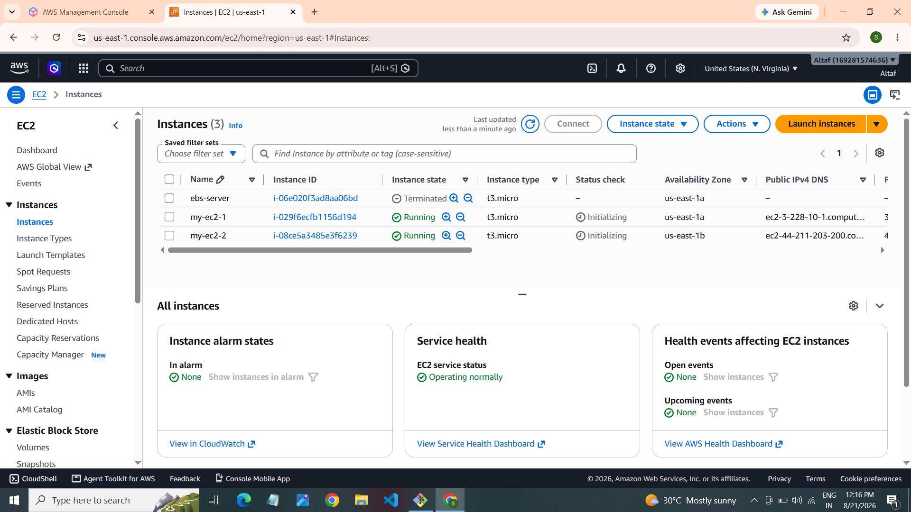
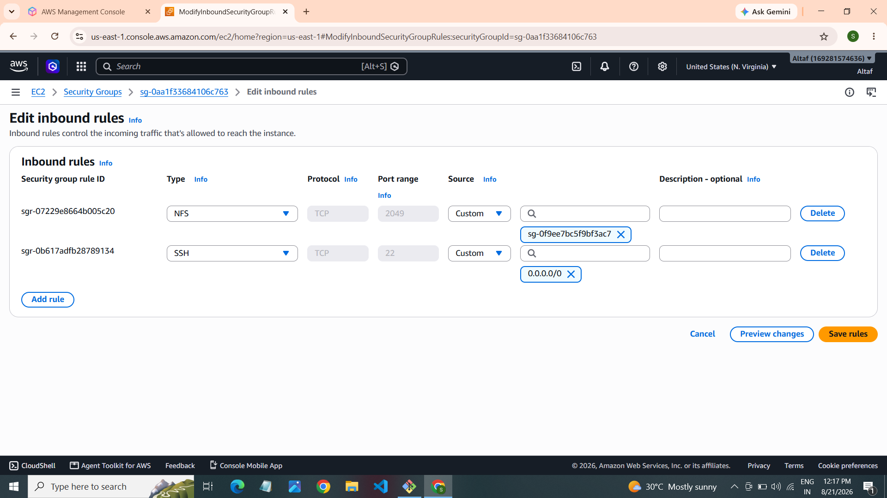
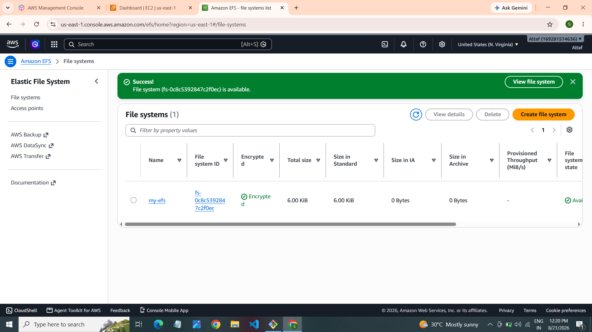
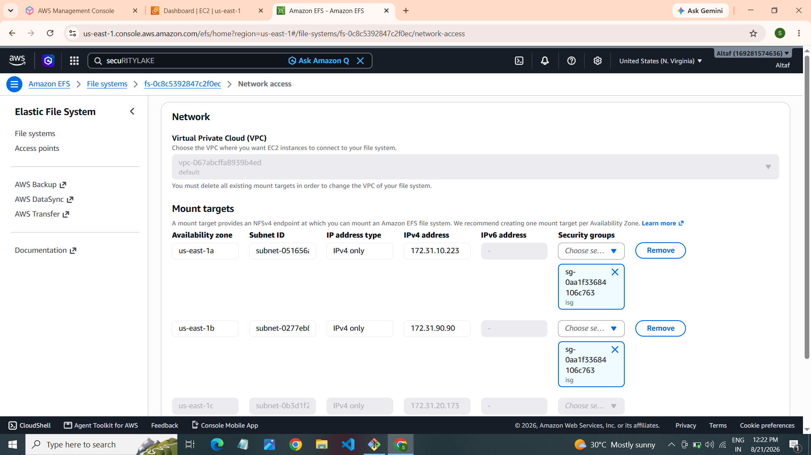
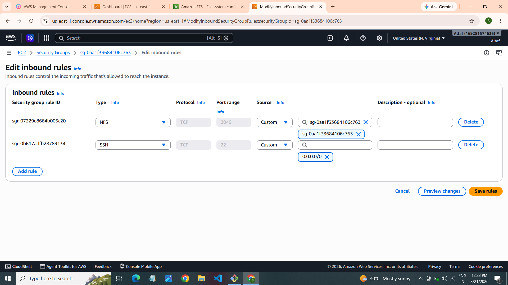
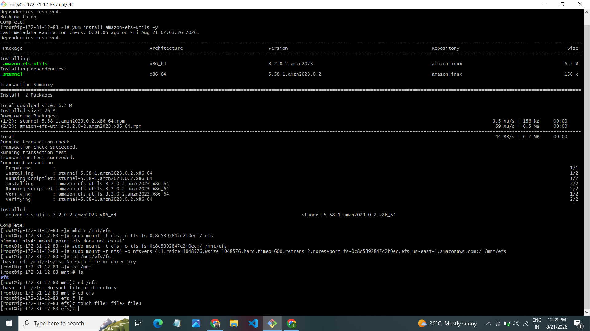
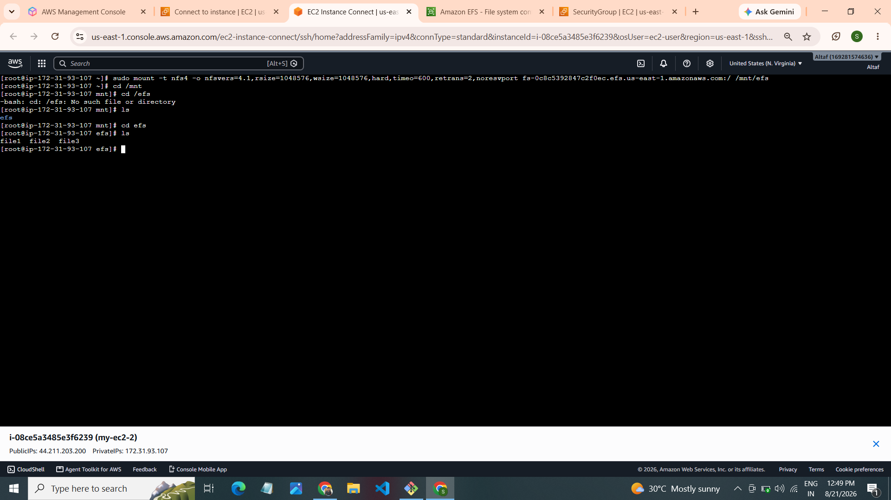

# AWS EFS Mount on Two EC2 Instances

## 📌 Project Overview

This project demonstrates how to create and mount **Amazon Elastic File System (EFS)** on two Amazon EC2 Linux instances.

EFS provides shared storage that allows multiple EC2 instances to access the same files simultaneously.

## 🏗️ AWS Architecture

```text
             AWS Cloud (VPC)
          ┌──────────────────────┐
          │                      │
          │   EC2 Instance 1     │
          │          │           │
          │          │           │
          │      Amazon EFS      │
          │          │           │
          │          │           │
          │   EC2 Instance 2     │
          │                      │
          └──────────────────────┘
```

## 🛠️ AWS Services Used

- Amazon EC2
- Amazon EFS
- Amazon VPC
- Security Groups
- Linux (Amazon Linux)
- NFS Protocol

## ⚙️ Implementation Steps

### Step 1: Launch EC2 Instances

- Launch two EC2 Linux instances.
- Configure the required security groups.
- Ensure both instances can access the EFS mount targets.

### Step 2: Create an EFS File System

- Open the Amazon EFS console.
- Create a new EFS file system.
- Select the required VPC.
- Configure mount targets.

### Step 3: Configure Security Groups

Allow NFS traffic:

| Protocol | Port | Purpose |
|---|---|---|
| TCP | 2049 | EFS access |
| TCP | 22 | SSH access |

Allow NFS traffic from the EC2 security group to the EFS security group.

### Step 4: Install EFS Utilities

```bash
sudo dnf install -y amazon-efs-utils
```

### Step 5: Create Mount Directory

```bash
sudo mkdir -p /mnt/efs
```

### Step 6: Mount EFS

Replace the file system ID with your actual EFS ID.

```bash
sudo mount -t efs -o tls fs-xxxxxxxxxxxxxxxxx:/ /mnt/efs
```

### Step 7: Verify EFS Mount

```bash
df -h
```

```bash
mount | grep efs
```

### Step 8: Test Shared Storage

On EC2 Instance 1:

```bash
echo "Hello from EC2 Instance 1" | sudo tee /mnt/efs/test.txt
```

On EC2 Instance 2:

```bash
cat /mnt/efs/test.txt
```

The same file can be accessed from both EC2 instances.

## 📸 Project Screenshots

### 1. EC2 Instances


### 2. EFS File System


### 3. EFS Configuration


### 4. Network Configuration


### 5. Security Group Configuration


### 6. EFS Mount Configuration


### 7. Mount Verification


## 🎯 Key Learnings

- Creating an Amazon EFS file system.
- Configuring EFS mount targets.
- Understanding NFS protocol and port 2049.
- Configuring EC2 and EFS security groups.
- Mounting EFS on Linux EC2 instances.
- Sharing files between multiple EC2 instances.

## 📁 Repository Structure

```text
aws-efs-mount-two-ec2/
│
├── README.md
│
└── screenshots/
    ├── step-1.png
    ├── step-2.png
    ├── step-3.png
    ├── step-4.png
    ├── step-5.png
    ├── step-6.png
    └── step-7.png
```

## 👨‍💻 Author

**AWS Cloud Computing Practical Project**

